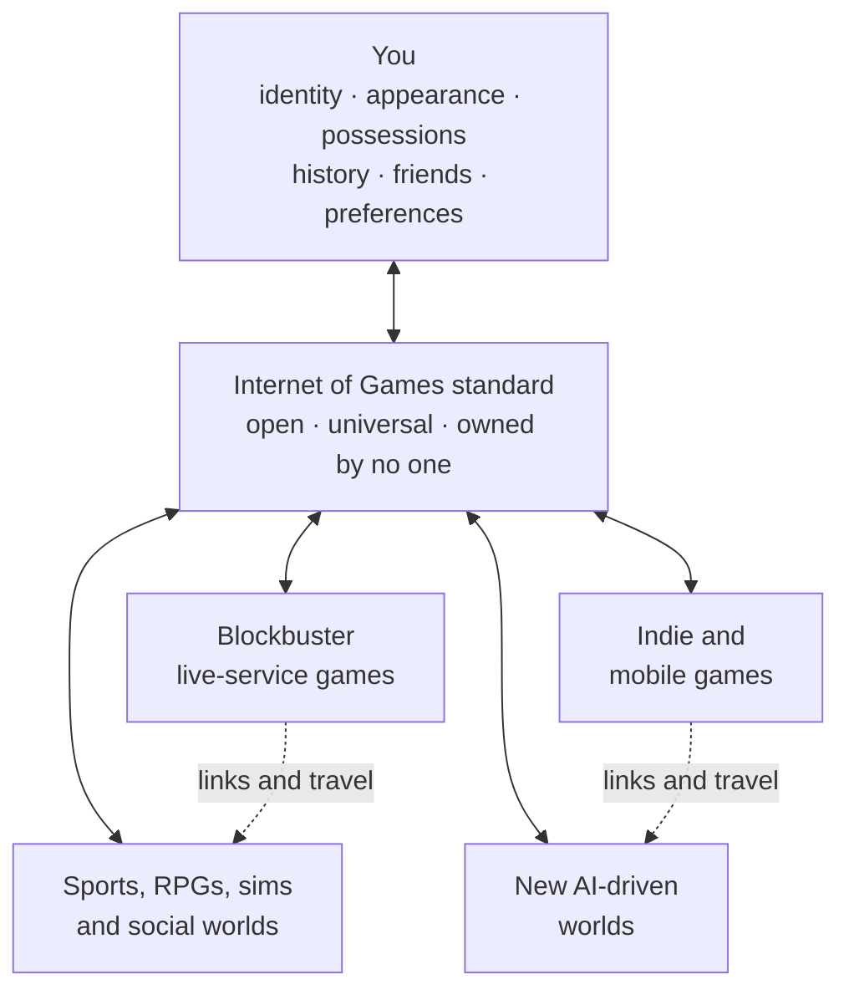

# Internet of Games

**The open standard for a connected gaming world. One identity across every game. Worlds that link together. Owned by no one.**

Today every game is an island. Your character, your look, the things you've earned and bought, your history and your friends are all locked inside each game, and games have no common way to connect to one another. The industry has already shown what players want: Roblox and Fortnite let people carry one identity across thousands of experiences, at enormous scale. But they do it **inside one company's platform**, and nothing connects those platforms to each other or to the rest of gaming.

**Internet of Games** is an open community building the **universal standard underneath a connected gaming world**. It's a common foundation that any game can build on, no matter who made it, what engine it uses or which platform it runs on. Web standards did this for websites; we want to do it for games.

## The mission

> **Build the open, universal standard that connects every game into one persistent universe. A player's identity, appearance, possessions, history and relationships travel with them, worlds link to each other the way websites do, and every game, from the biggest blockbuster to a one-person project, can build on it.**

That's the destination, and we'll get there by proving one layer at a time. The first milestone is small on purpose, because a small proof that works is more convincing than a big plan:

> **First milestone:** two games built by different teams on different engines that recognize the same player, show the same avatar, and honor an achievement earned in the other game, with no shared servers.

## Status: Phase 0, defining the problem

There's no spec and no code yet, on purpose. Right now this repository holds the **problem docs**: what the problem is, why it's still unsolved in late 2026, what already exists, and a numbered list of sub-problems anyone can pick up. Specifications and reference code will live here too as the phases progress (see [ROADMAP.md](ROADMAP.md)).

## Start here

| If you want to… | Read |
|---|---|
| Get the idea in five minutes | [VISION.md](VISION.md) |
| Know why the biggest games aren't connected already | [Why doesn't NBA 2K plug into GTA VI?](docs/why-not-yet.md) |
| See the precise problem, scope and success criteria | [Problem statement](docs/problem-statement.md) |
| See what exists today | [Landscape, late 2026](docs/landscape-2026.md) · [Prior art](docs/prior-art.md) · [Standards map](docs/standards-map.md) |
| Understand the shape of the standard | [Layer model](docs/layer-model.md) · [What should travel](docs/portability-matrix.md) · [Design principles](docs/design-principles.md) |
| Pick a problem to work on | [problems/](problems/README.md) |
| See the plan | [ROADMAP.md](ROADMAP.md) |
| See what's been decided | [Decision records](docs/decisions/README.md) |
| Contribute | [CONTRIBUTING.md](CONTRIBUTING.md) |
| Work here with an AI agent | [AGENTS.md](AGENTS.md) |

The full reading guide is in [docs/README.md](docs/README.md).

## The idea in one picture

Every game keeps its own rules, economy and art style. The standard defines how the things that make up *you* travel between games, and how worlds link to each other. Each game decides what those things mean in its own world. Nintendo's amiibo already works this way inside one company: one figure works in many games, and each game decides what it does ([details](docs/prior-art.md#nintendo-amiibo)).

## What the standard covers

The standard is a stack of layers ([layer model](docs/layer-model.md)), and each game uses the layers it needs:

| Layer | What it lets games do | When |
|---|---|---|
| **Identity** | Recognize the same player everywhere, privately and safely | First |
| **Appearance** | Show the player's look, adapted to each game's art style | First |
| **History** | Honor what the player did in other games | First |
| **Travel and links** | Let players move between worlds, and let worlds link to each other | Next |
| **Ownership** | Let things players earn or buy carry across games | Later |
| **Economy** | Let value move between games | Research |
| **Shared worlds** | Let actions have consequences across games, and let AI characters travel | Research |

The order reflects risk, not importance. Identity, appearance and history can work without anyone sharing an economy or a license, so they come first. Ownership and economies come later because they carry the most legal and business risk ([here's why](docs/why-not-yet.md)).

## What it is not

- **Not one company's platform, store or launcher.** It's an open standard that platforms, games and services can all build on.
- **Not a replacement for each game's rules.** Every game still decides what imported things mean in its world.
- **Not crypto.** No blockchain, token or wallet is ever required.
- **Not affiliated** with any company named in these docs ([TRADEMARKS.md](TRADEMARKS.md)).

## Problem IDs

Every sub-problem has a stable ID (`P-0001` to `P-0030`), and every open question inside a problem doc has its own ID too, for example `P-0008-Q2`. Please use these IDs in issues, pull requests and discussions so conversations stay linked to the docs. The index is in [problems/README.md](problems/README.md).

## Get involved

- **Discuss:** start a thread in GitHub Discussions on this repository.
- **Fix or add evidence:** every factual claim should have a source. If you find one that's wrong or out of date, open an issue with the *Evidence / correction* template.
- **Propose a problem:** open an issue with the *New problem* template.
- **Already working in this space?** That includes OMI, Khronos, the VRM Consortium, W3C, DIF, the OpenID Foundation, the Metaverse Standards Forum, game studios and platforms. We want to *build on* your work, not compete with it, so please open a discussion.

## Licenses

Each kind of file has its own license ([ADR-0009](docs/decisions/ADR-0009-say-which-license-covers-each-kind-of-file.md)):

| Files | License |
|---|---|
| Documents: every Markdown file, including future specification text | [Creative Commons Attribution 4.0](LICENSE-DOCS) |
| Code and every other file, such as tools, workflows, configuration and schemas | [Apache License 2.0](LICENSE) |
| Code samples and schemas inside documents | CC BY 4.0 or Apache-2.0, your choice |
| Test files and sample assets | [CC0 1.0](LICENSE-CC0), no rights reserved |

- Specification text will also get a patent policy, decided before any is merged ([P-0001](problems/P-0001-neutral-governance-and-ip.md)).
- Contributions are accepted under the [Developer Certificate of Origin](https://developercertificate.org/). Sign off your commits with `git commit -s`; see [CONTRIBUTING.md](CONTRIBUTING.md).
- The licenses don't cover the project's name or anyone else's: [TRADEMARKS.md](TRADEMARKS.md)

Founded by [@acterra12](https://github.com/acterra12). Built by everyone who shows up.
