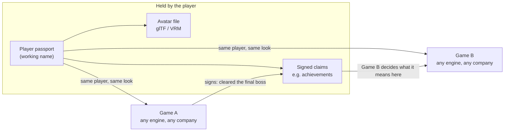

# Internet of Games

**One character. Many independent games. No single owner.**

Today every game is its own universe. Starting a new game means creating a new person from scratch, and that person's name, look and history stay locked inside that one game. The industry has already shown that people want one persistent identity across many experiences: Roblox and Fortnite deliver that at enormous scale, but only **inside one company's platform**. Nobody has made it work **between** games built by different companies, on different engines, with different servers.

**Internet of Games** is an open community working on the building blocks for that. One question guides the work:

> **What is the smallest open standard, and the smallest working prototype, that would let two independently developed games recognize the same player character and preserve meaningful continuity between them?**

## Status: Phase 0, defining the problem

There's no spec and no code yet, on purpose. This repository currently holds the **problem docs**. They cover exactly what the problem is, why it's still unsolved in late 2026, what already exists, and a numbered list of sub-problems anyone can pick up. Specs and reference code will live here too once Phase 1 begins (see [ROADMAP.md](ROADMAP.md)).

## Start here

| If you want to… | Read |
|---|---|
| Get the idea in five minutes | [VISION.md](VISION.md) |
| Know why big publishers aren't already doing this | [Why doesn't NBA 2K plug into GTA VI?](docs/why-not-yet.md) |
| See the precise problem, scope and success criteria | [Problem statement](docs/problem-statement.md) |
| See what exists today | [Landscape, late 2026](docs/landscape-2026.md) · [Prior art](docs/prior-art.md) · [Standards map](docs/standards-map.md) |
| Understand the proposed shape of a solution | [Layer model](docs/layer-model.md) · [What should travel](docs/portability-matrix.md) · [Design principles](docs/design-principles.md) |
| Pick a problem to work on | [problems/](problems/README.md) |
| See the plan | [ROADMAP.md](ROADMAP.md) |
| Contribute | [CONTRIBUTING.md](CONTRIBUTING.md) |

The full reading guide is in [docs/README.md](docs/README.md).

## The idea in one picture

Each game keeps its own rules, economy and art style. What travels is small: **who you are, what you look like, and verifiable facts about what you've done.** Each receiving game decides what those facts mean in its own world. Nintendo's amiibo already works this way within a single company: one figure works in many games, and each game decides what it does ([details](docs/prior-art.md#nintendo-amiibo)).

## What we're building, and what we're not

**What we're building (open and vendor-neutral):**

- a small, portable *player document* that points to things the player controls
- conventions for a portable avatar, based on the open glTF and VRM formats
- a vocabulary for signed, portable achievements and history, based on W3C Verifiable Credentials and Open Badges 3.0
- validators, test files and SDKs, plus two small independent demo games that prove the approach works

**What we're not building:**

- a game, a launcher, a store, or a platform everyone has to join
- anything that *requires* crypto, tokens or a wallet
- a way to move currencies, stats or licensed content between games ([here's why](docs/portability-matrix.md))
- anything affiliated with the companies named in these docs ([TRADEMARKS.md](TRADEMARKS.md))

## Problem IDs

Every sub-problem has a stable ID (`P-0001` to `P-0028`), and every open question inside a problem doc has its own ID (for example `P-0008-Q2`). Use these IDs in issues, pull requests and discussions so conversations stay linked to the docs. The full index is in [problems/README.md](problems/README.md).

## Get involved

- **Discuss.** Use GitHub Discussions on this repository.
- **Fix or add evidence.** Every factual claim should carry a source. If you find one that's wrong or out of date, open an issue with the *Evidence / correction* template.
- **Propose a problem.** Use the *New problem* issue template.
- **Already working in this space?** That includes OMI, Khronos, the VRM Consortium, W3C, DIF, the OpenID Foundation, the Metaverse Standards Forum and game studios. We want to *build on* your work, not compete with it, so please open a discussion.

## Licenses

- Code: [Apache License 2.0](LICENSE)
- Documentation and specifications: [Creative Commons Attribution 4.0](LICENSE-DOCS)
- Contributions are accepted under the [Developer Certificate of Origin](https://developercertificate.org/). Sign off your commits with `git commit -s`; see [CONTRIBUTING.md](CONTRIBUTING.md).
- Third-party names: [TRADEMARKS.md](TRADEMARKS.md)

Founded by [@acterra12](https://github.com/acterra12). Built by everyone who shows up.
