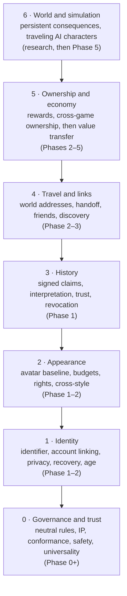
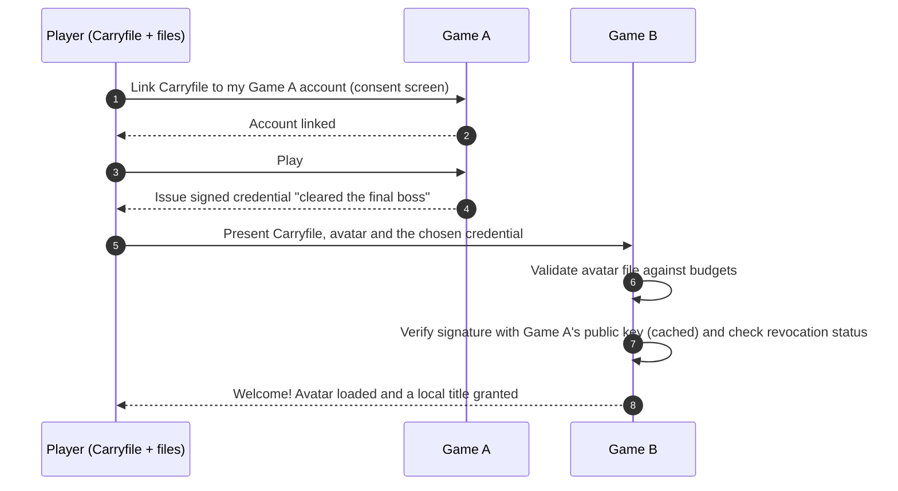

# Layer model: the Internet of Games stack

*Last reviewed: 2026-11-15. This is the planned shape of the standard; it isn't a specification yet.*

The standard is a stack of layers, like the layers of the internet. Each game uses the layers it needs: a small game might use only identity and appearance, while a large one uses all of them. Building the layers in order of risk lets the hard parts, such as economies and shared world state, mature without blocking what we can do now.

Each layer depends only on the layers below it. **Phase 1 needs layers 0 to 3.**

## Layer 0: Governance and trust

Who sets the rules, how the IP works, what "compatible" means, how safety is handled, and how the standard stays usable by every kind of game.
Problems: [P-0001](../problems/P-0001-neutral-governance-and-ip.md), [P-0002](../problems/P-0002-why-would-a-game-join.md), [P-0024](../problems/P-0024-durability-when-services-die.md), [P-0025](../problems/P-0025-developer-adoption-cost.md), [P-0026](../problems/P-0026-conformance-and-interop-testing.md), [P-0030](../problems/P-0030-built-for-every-game.md).

## Layer 1: Identity

A stable identifier the player controls, linked to each game's existing accounts, with privacy, recovery and age signals.
Problems: [P-0003](../problems/P-0003-player-identifier.md), [P-0004](../problems/P-0004-account-linking.md), [P-0005](../problems/P-0005-key-recovery.md), [P-0006](../problems/P-0006-privacy-unlinkability.md), [P-0007](../problems/P-0007-age-and-eligibility.md), [P-0028](../problems/P-0028-portable-preferences.md).

## Layer 2: Appearance

What the player looks like: a portable avatar file, a style-independent description, a 2D portrait, budgets and rights.
Problems: [P-0008](../problems/P-0008-avatar-baseline.md), [P-0009](../problems/P-0009-cross-style-translation.md), [P-0010](../problems/P-0010-avatar-budgets-and-file-safety.md), [P-0011](../problems/P-0011-rights-licensing-likeness.md), [P-0012](../problems/P-0012-moderating-imported-identity.md).

## Layer 3: History

Signed facts about what the player did, how other games interpret them, and how trust and revocation work.
Problems: [P-0013](../problems/P-0013-portable-claims.md), [P-0014](../problems/P-0014-claim-interpretation.md), [P-0015](../problems/P-0015-issuer-trust-revocation.md), [P-0016](../problems/P-0016-portable-reputation.md).

## Layer 4: Travel and links

Addresses for worlds and the places inside them, links between worlds, moving between games, finding friends and finding games. This is the layer that turns separate games into one connected universe.
Problems: [P-0017](../problems/P-0017-world-handoff.md), [P-0018](../problems/P-0018-friends-and-presence.md), [P-0027](../problems/P-0027-discovery.md), [P-0029](../problems/P-0029-world-addressing-and-links.md).

## Layer 5: Ownership and economy

Rewards that cross games as entitlements first. Then purchased and licensed items that travel once rights holders and platforms opt in. Value transfer comes after research. Platform-holder rules apply throughout.
Problems: [P-0019](../problems/P-0019-cross-game-entitlements.md), [P-0020](../problems/P-0020-connected-economies.md), [P-0021](../problems/P-0021-platform-holder-rules.md).

## Layer 6: World and simulation

Consequences and characters that persist across worlds.
Problems: [P-0022](../problems/P-0022-persistent-consequences.md), [P-0023](../problems/P-0023-traveling-ai-characters.md).

## The roles

We borrow the roles from the [Verifiable Credentials model](https://www.w3.org/TR/vc-data-model-2.0/):

| Role | In the Internet of Games |
|---|---|
| **Holder** | The player, or software acting on the player's behalf (a "Carryfile app"). Holds the Carryfile, the avatar files and the credentials. |
| **Issuer** | A game, or another trusted party, that signs a claim about the player, for example "cleared the final boss" or "is over 13". |
| **Verifier** | A game that checks a claim before using it. |
| **Interpreter** | The same receiving game, deciding what a verified claim *means* locally. This step is ours; it's not part of the VC model. |

## The basic flow (Phase 1)

There's no server-to-server integration between Game A and Game B, and no business relationship is required. Game B only needs Game A's **public** keys, which are published and can be cached, and its own local rules for what a Game A credential is worth.

## What is deliberately *not* in the flow

- No central account server, ours included.
- No currency or stats moving between games.
- No requirement that Game B accept anything; every step is opt-in on both sides.
- No blockchain. One could be used underneath some identifier methods, but none is required.
