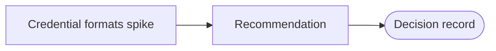

# Writing visual summaries

Long descriptions are hard to take in. A visual summary puts the point first: a picture, three short lines and a diagram. The full text sits folded underneath, and a PDF holds everything for reading offline.

## What it looks like

1. **A summary card:** an image showing the kind and number, the status, the title, the three points and up to four facts.
2. **Three short lines** with links: usually what changes, why, and what you need from the reader.
3. **A diagram** in a `mermaid` code block. GitHub draws it, and people and agents can still read its source.
4. **A link to the PDF digest,** once it's attached: the card, the three lines, the diagram and the full text in one file, with working links.
5. **The full details,** folded in a `
` block: the full description, the sources and the checklist.

Images can't be searched, translated or read aloud, so everything the card shows must also be in the text. The card repeats the three lines; it never replaces them. Its alt text names the card and gives the title, status and facts.

## When to use it

| Where | Use it |
|---|---|
| Pull request descriptions | Always |
| New issues and Discussions | Always |
| Comments | When reporting a result, or when the comment runs past about 150 words. Short replies stay plain text |

## Steps

1. **Write a brief** in a scratch folder outside the repository, such as one made with `mktemp -d`. It's a session artifact, so it never gets committed ([AGENTS.md](../../AGENTS.md), rule 12). Use the template below.
2. **Build the files:** `make visuals BRIEF=path/to/brief.md`. This writes `<name>-card.png`, `<name>-body.md` and `<name>-digest.pdf` next to the brief. It needs Chrome or Chromium, and it refuses a brief that contains personal data or secrets.
3. **Look at all three.** Check that nothing on the card is cut off, that the status is right, that the links in the description and the PDF go where they should, and that there are no third-party images.
4. **Get your human's go-ahead** (rule 18). Once uploaded, an image in a public repository can be opened by anyone with its link, even after you edit the description.
5. **Post it** with gh 2.103 or later. gh uploads the card and puts its address in place of the local file name:
   - new pull request: `gh pr create --title "…" --body-file <name>-body.md --attach <name>-card.png`
   - existing pull request: `gh pr edit <number> --body-file <name>-body.md --attach <name>-card.png`
   - new issue: `gh issue create --title "…" --body-file <name>-body.md --attach <name>-card.png`
   - comment: `gh pr comment <number> --body-file <name>-body.md --attach <name>-card.png`, or `gh issue comment`
6. **Attach the PDF.** gh can't upload PDFs, so ask your human to drag `<name>-digest.pdf` into a comment on the pull request or issue. Then link it from the description:
   1. Find the two uploaded files' addresses with `gh pr view <number> --json body,comments`. They contain `user-attachments`.
   2. Rebuild: `make visuals BRIEF=path/to/brief.md ARGS="--card-url <card address> --pdf <PDF address>"`.
   3. Post the new description without `--attach`, so the card isn't uploaded twice: `gh pr edit <number> --body-file <name>-body.md`.

## The brief

~~~markdown
---
kind: Pull request #12
title: Compare credential formats for achievement claims
status: Ready for review
url: https://github.com/internet-of-games/internet-of-games/pull/12
ref: <the commit's full hash>
---

## What
A spike comparing Open Badges 3.0 and SD-JWT credentials for achievement claims ([P-0013](problems/P-0013-portable-claims.md)).

## Why
Phase 1 needs one format that both demo games can verify offline.

## Ask
Review the recommendation. It becomes a decision record once we agree.

## Facts
- 1 spike
- 2 formats compared

## Diagram

## Details
The full description, the sources and the pull request checklist. Headings are fine here.

## Footer
Shown after the folded details, for example to say an agent helped.
~~~

- **Front matter.** Only `title` is required. `kind` and `status` appear at the top of the card. `url` is the page's address, shown on the card and in the PDF. `repo` and `ref` say where relative links point: by default this repository at your current commit, which must be pushed. `alt` replaces the generated alt text, and `date` and `brand` change the card's footer.
- **Points.** The first three sections are the points, and their headings become the labels.
- **Optional sections.** `## Facts`, `## Diagram`, `## Details` and `## Footer` are optional. Everything from `## Details` up to `## Footer` is the folded text.
- **Links.** Relative links, such as `docs/glossary.md`, become links to that file at `ref`. On a pull request, set `ref` to the full hash of its latest commit: links to a branch break when the branch is deleted after merging.

## Writing rules

- **Title:** 80 characters or fewer.
- **Points:** one sentence each, 140 characters or fewer, not counting link addresses, linking to what they mention. Labels have 12 characters or fewer. Pull requests use What, Why and Ask; issues can use Problem, Why and Help.
- **Facts:** up to four, of 24 characters or fewer: counts and IDs, such as "6 spikes" or "ADR-0009".
- **Diagram:** 12 nodes or fewer, with labels of a few words. GitHub shrinks a diagram to fit the page's width, so a long left-to-right chain ends up too small to read: use `flowchart TD`, and `flowchart LR` only when no row has more than four boxes. Start with `accTitle:` and `accDescr:` lines, so screen readers get a title and a description. Don't set colors: GitHub picks ones that suit each reader's light or dark theme.
- **Only our own work:** no logos, screenshots or other people's images on the card or in the diagram ([AGENTS.md](../../AGENTS.md), rule 1). The card is text only, and the PDF fetches nothing from the network.
- **Keep it true:** the card and the three lines summarize the text below them. They never claim more than it does.
