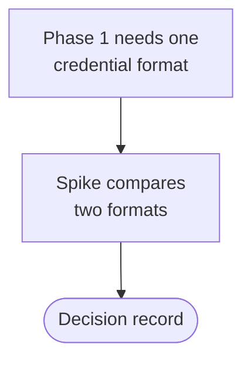

# Writing descriptions

Pull requests, issues and Discussions are plain Markdown that anyone can edit on GitHub. Put the point first, link what you mention, and add a diagram only when the text gets too long to follow.

## Every description

1. **Three short lines first.** Pull requests use **What:**, **Why:** and **Ask:**: the change, the problem it solves, and what you need from reviewers, including the merge order if it matters. Issues use **Problem:**, **Why:** and **Help:**. Keep each to one sentence that links to what it mentions.
2. **Then the details:** what changed and why, any guardrail files changed ([AGENTS.md](../../AGENTS.md), rule 15), anything still open, and the checklist from the template.
3. **Link files with full addresses pinned to a commit,** such as `https://github.com/internet-of-games/internet-of-games/blob/<commit>/docs/glossary.md`. Relative links don't work in descriptions, and links to a branch break once the branch is deleted. Write issues and pull requests as `#12`.
4. **No images.** A picture of text can't be edited, searched, translated or read aloud, so don't add summary cards, screenshots of text or PDF copies. When a change is itself visual, such as how an avatar renders, an image of our own work is fine, with alt text.
5. **Say if an AI agent helped.**

## Add a diagram when the text is too long

When the description runs past about 300 words before the checklist, add one diagram after the three short lines, and fold the rest into `

<b>Full details</b>
` … `
`. Shorter descriptions get no diagram and no folding.

The diagram shows the problem, the change and the fix, and its boxes link to the files, issues and pull requests they stand for. GitHub opens a box's link when someone clicks it.

~~~markdown

~~~

- **12 boxes or fewer,** with labels of a few words.
- **Top to bottom.** GitHub shrinks a diagram to fit the page, so a long left-to-right chain becomes too small to read. Use `flowchart TD`, and `flowchart LR` only when no row has more than four boxes.
- **Link with full addresses:** `click <box> href "https://…"`. GitHub ignores links that start with `#`, so write `https://github.com/internet-of-games/internet-of-games/pull/12` rather than `#12`.
- **Start with `accTitle:` and `accDescr:`,** so screen readers get a title and a description.
- **Everything the diagram shows is also in the text,** with the same links.
- **Don't set colors.** GitHub picks ones that suit each reader's light or dark theme.

## Posting and editing

- **Get your human's go-ahead** before you post anything ([AGENTS.md](../../AGENTS.md), rule 18).
- **Check the text first:** no personal data, secrets or notes from your session ([AGENTS.md](../../AGENTS.md), rules 1 and 12).
- **Post** with `gh pr create --title "…" --body-file body.md`, `gh issue create --title "…" --body-file body.md` or `gh pr comment <number> --body-file body.md`.
- **Edit the live text,** since people may have changed it on GitHub: `gh pr view <number> --json body -q .body > body.md`, change `body.md`, then `gh pr edit <number> --body-file body.md`.
- **Look at the page after posting.** If a diagram shows "Unable to render rich display", reload once before you change anything, because the first load can time out. If it still fails, fix the diagram's syntax.
